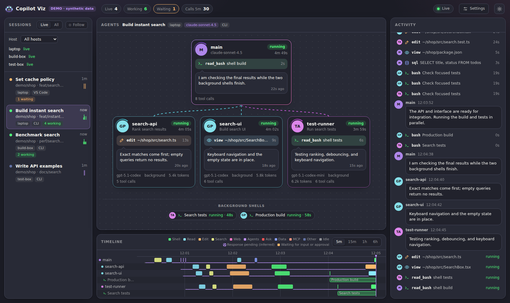
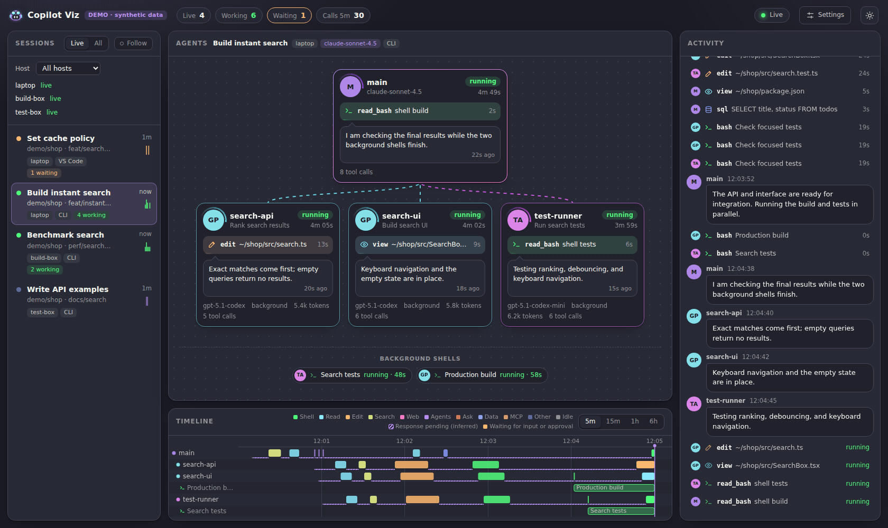
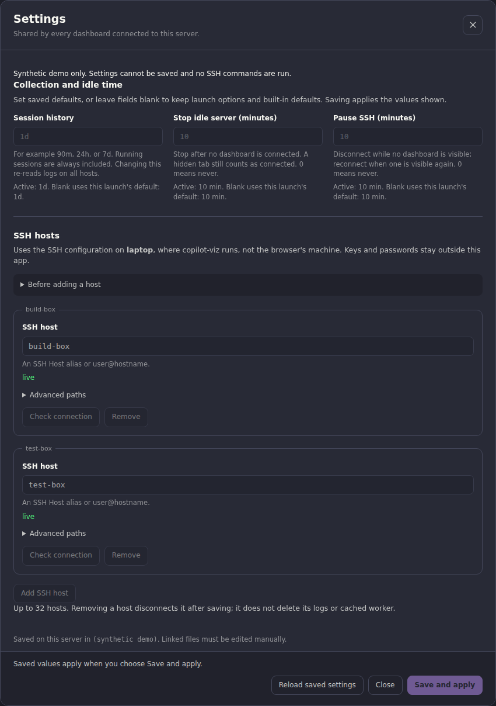

# copilot-viz

A live browser dashboard of [GitHub Copilot CLI](https://github.com/github/copilot-cli) sessions.
It shows what every agent and subagent is doing, the tool calls and background shells on a
timeline, and an activity feed, for the sessions on this machine and on SSH hosts.

copilot-viz is an unofficial tool. It is not affiliated with or endorsed by GitHub.



*The real dashboard with synthetic demo data. All sessions, prompts, commands, results, and hosts
in these images are fictional; no real session logs are shown.*

<details>
<summary>Watch the 28-second demo</summary>



</details>

## Features

- **Sessions**: the sessions whose log changed recently, running ones first. *Follow* keeps the
  busiest session in view.
- **Agents**: the main agent and its subagents as a map, with their state: running, waiting for an
  answer or an approval from you, idle, or done, and their background shells.
- **Timeline**: tool calls and background shells per agent, over the last 5 minutes to 6 hours.
- **Activity**: prompts, replies, and tool calls as they happen. Select a call to see its
  arguments and result.
- **Remote hosts**: sessions on SSH hosts appear next to the local ones, each with its own clock.
- **Settings**: register and check SSH hosts, and change collection and idle timers, without
  restarting the dashboard.

The dashboard reads the session logs in `~/.copilot/session-state` and never writes to them. It
needs no change to Copilot CLI, and it shows sessions that started before it did.

## Requirements

- Node.js 22 or later
- Linux, macOS, or WSL. Native Windows is not supported; run it in WSL.
- For remote hosts: OpenSSH, and Node.js 22 or later on each host

## Install

```sh
npm install --global copilot-viz
```

Or install the latest commit from GitHub:

```sh
npm install --global github:yosh-matsuda/copilot-viz
```

## Usage

```sh
copilot-viz            # start the server if needed and open a new link in the browser
copilot-viz status     # show the running server
copilot-viz stop       # stop it
copilot-viz --help     # all commands and options
```

The server runs in the background on `127.0.0.1` (port 7421, or a free port when it is taken). It
exits after 10 minutes without a viewer by default. `--since 7d` shows the sessions of the last 7 days
instead of 24 hours. Running sessions are always shown.

Over SSH, `copilot-viz --no-open` prints the link, and you forward the port from your machine:

```sh
ssh -L 7421:127.0.0.1:7421 host
```

The server starts again with the new code after an upgrade, on the next `copilot-viz`.

## Settings

Open **Settings** in the header. Changes are shared by all pages connected to this server.
**Save and apply** writes `~/.copilot/copilot-viz.json` (under `COPILOT_HOME` when set) and applies
the settings without changing the server's port, pairing token, or open browser connections.

<details>
<summary>Preview the Settings screen</summary>



</details>

| Setting | Meaning |
| --- | --- |
| Session history | Include sessions whose logs changed within a duration such as `90m`, `24h`, or `7d`. Running sessions are always included. This is separate from the timeline's zoom. Changing it re-reads logs on every host. |
| Stop idle server | Minutes without any connected dashboard; `0` means never. A hidden browser tab still counts as connected. |
| Pause SSH | Minutes without a visible dashboard before disconnecting SSH; `0` means never. Connections resume when a dashboard becomes visible. |

Leave a field blank to avoid saving a default for it. The screen shows both its active value and
this launch's default. Without saved settings or explicit options, session history is 24 hours,
SSH pauses after 10 minutes, and the server exits after 10 minutes for `copilot-viz` or never for
`copilot-viz serve`. An SSH-host-only edit does not turn these implicit defaults into saved ones.

Explicit CLI options take precedence when starting the server. **Save and apply** uses the saved
values shown in the form; a blank field uses that launch's option or built-in default.
The theme, session filter, and timeline zoom remain per-browser preferences.

Saving checks whether another page or editor changed the file, then replaces it atomically.
On a conflict, **Reload saved settings** discards the draft and reads the current file. Linked
configuration files must be edited manually; the dashboard does not replace their links.
Other programs are not locked out; avoid editing the file while saving in the dashboard.
Manual file edits take effect on the next `copilot-viz` command.

## Remote hosts

Install copilot-viz only on the machine running the dashboard. Remote hosts need SSH access and
Node.js 22 or later; they do not need their own copilot-viz or npm installation.

### Prepare SSH once

Use a terminal **on the machine running copilot-viz**, not necessarily the machine running the
browser. If copilot-viz runs in WSL, use the SSH configuration and agent inside WSL.
For example, a host entry in `~/.ssh/config` might be:

```sshconfig
Host build-server
    HostName build.example.com
    User dev
    IdentityFile ~/.ssh/id_ed25519
```

1. Run `ssh build-server`. Verify the host fingerprint with the administrator before accepting
   it, and unlock your key with `ssh-agent` if needed.
2. Verify a fresh, non-interactive connection succeeds without a prompt:

   ```sh
   ssh -o BatchMode=yes -o StrictHostKeyChecking=yes \
       -o ControlMaster=no -o ControlPath=none build-server 'node --version'
   ```

   It must report Node.js 22 or later. If Node is available only in an interactive shell, find
   its absolute executable path there with `command -v node` and use that path below.

### Register the host

1. Open **Settings**, choose **Add SSH host**, and enter the same SSH host name or alias.
2. Under **Advanced paths**, set the Node.js executable or remote Copilot home only when needed.
   Paths are absolute or relative to the remote home; `~` and environment variables are not
   expanded inside them.
3. Choose **Check connection**. It checks fresh batch SSH access, Node.js, and session-directory
   access without installing the worker or reading session logs. A missing session directory
   is a note, not a failure: start Copilot CLI on the host when ready.
4. Choose **Save and apply**. New hosts connect immediately. Editing an SSH entry reconnects
   only that host; deleting it disconnects it. Neither action deletes its session logs or cache.

Offline hosts can be saved without a successful check. Their connection status and error appear
in Settings and in the session list. A check does not run or validate a custom worker script.
SSH usernames, ports, keys, `ProxyJump`, and other SSH options remain in your OpenSSH configuration.
The app has no password or private-key fields.

| Failure | What to check |
| --- | --- |
| Host key verification failed | Run SSH in a terminal and verify the host fingerprint before accepting it. The app does not bypass strict checking. |
| Permission denied / agent refused | Unlock the correct key in the SSH agent available to copilot-viz, and retry batch SSH. Password-only authentication is not supported. |
| Could not resolve hostname | Check the name and the SSH configuration on the machine running copilot-viz. |
| Node not found / unsupported version | Set an absolute Node.js 22+ executable path under Advanced paths. |
| Directory access error | Check the remote Copilot home and its permissions. |
| Check passes, worker stays offline | Read the host's connection error. Worker cache permissions or an incompatible custom script can fail after the basic check. |

### Configuration file

The screen writes version 2. You can also edit the file manually:

```json
{
  "version": 2,
  "since": "24h",
  "idleExitMinutes": 10,
  "pauseRemotesMinutes": 10,
  "remotes": [
    { "host": "build-server" },
    { "host": "gpu-box", "node": "/opt/node22/bin/node" }
  ]
}
```

The three runtime fields are optional. Timer values are nonnegative minutes; `0` disables the
timer. `pauseRemotesMinutes` must fit a JavaScript timeout (at most about 24.9 days).
There can be up to 32 hosts. Existing version-1 files containing only `version` and `remotes`
still load; saving from Settings upgrades them to version 2. Older copilot-viz versions cannot
read version 2. Invalid values and unknown keys are rejected; the file is limited to 1 MiB.

Each remote accepts:

| Key | Meaning |
| --- | --- |
| `host` | A host name or `Host` alias of your SSH configuration (required) |
| `node` | The Node.js 22+ command on the host (default `node`). Non-interactive SSH sessions often have a shorter `PATH`, so an absolute path is safer. |
| `copilotHome` | The Copilot home on the host (default `~/.copilot`) |
| `script` | A worker script to run instead of the installed copy, for development |

For each host, copilot-viz runs `ssh` in batch mode with strict host key checking, so the host key
must already be known and the key must work without a prompt, for example through `ssh-agent`. The connection runs a
read-only worker that sends the sessions back over SSH; nothing listens on the host.

### Worker installation and pause

The first connection to a host copies the worker (about 90 KB) to
`~/.cache/copilot-viz/worker/<digest>/` on that host, and each later connection verifies its
SHA-256 digest before starting it. A new version of copilot-viz copies its own worker. The path must be private:
copilot-viz refuses to start the worker when another user could change `~/.cache` or anything below it.
`~/.cache` itself may be a symlink and may be writable by your own primary group, as with `umask 002`;
the directories that copilot-viz creates below it may not be symlinks. To remove the worker, delete
`~/.cache/copilot-viz` on the host.

By default, copilot-viz disconnects the hosts after 10 minutes without a page in view, and
connects again when one comes back. The **Pause SSH** setting changes this timeout.

## Security and privacy

Session logs hold your prompts, the replies, and the output of every tool call, which can include
secrets. copilot-viz shows them to whoever can open the dashboard, so it guards the page:

- The server listens on `127.0.0.1` only.
- A link works once: the command hands out a single-use pairing code through a socket in an
  owner-only runtime directory, and the page trades the code for a token that lives only in the
  server process.
- On Linux, the server checks which user owns the other end of each connection and refuses other
  users. In WSL, it also accepts connections that the WSL localhost relay makes as root and
  connections whose owner it cannot see, because Windows programs reach the server that way.
- macOS has no such check. Another user who is logged in to the same Mac can reach the port, but
  still needs a pairing code.

A paired page can change settings and use the server user's SSH access, including running the
configured Node.js executable or custom worker on a host. Pairing grants administration, not
read-only viewing. Only share a pairing link with someone you trust with that access.
The connection check is not a safety check for an arbitrary executable.

Please report a vulnerability privately; see the
[security policy](https://github.com/yosh-matsuda/copilot-viz/security/policy).

## Limitations

- Copilot CLI does not document its log format. A new version of Copilot CLI can change what the
  dashboard shows until copilot-viz follows the change.
- The first load reads every log within `--since`. With thousands of sessions, a long window takes
  a while, and new events wait until it finishes.
- On an SSH host without a display, the browser command still runs. Set `BROWSER` or use
  `--no-open` when that is not wanted.

## Development

The code has no dependencies.

```sh
npm test         # unit and integration tests
npm run smoke    # pack, install into a temporary prefix, and run the installed command
```

### Try a checkout

Run `npm run demo` to explore the dashboard with synthetic data and read-only settings.
No installation is needed; open the URL printed in the terminal.

To try the real collector and save settings without changing an installed copy's configuration,
run the following in Bash or another POSIX shell, from the checkout:

```sh
(
  set -eu
  preview="$(mktemp -d /tmp/copilot-viz-preview.XXXXXX)"
  mkdir -m 700 "$preview/home" "$preview/runtime"
  ln -s "$HOME/.copilot/session-state" "$preview/home/session-state"
  printf 'Preview directory: %s\n' "$preview"
  exec env COPILOT_HOME="$preview/home" XDG_RUNTIME_DIR="$preview/runtime" \
    node src/cli.mjs serve --port 0
)
```

If your Copilot logs live elsewhere, replace `$HOME/.copilot/session-state` with their absolute
path. The symlink lets the collector read your existing logs; it never writes to them.
The preview starts with no SSH hosts. Settings are saved only in the printed preview directory,
and the separate runtime directory lets it run alongside an installed copy. Open the printed
pairing link within two minutes. Stop with Ctrl+C; the preview directory remains for inspection
or reuse. SSH hosts you register use your normal SSH configuration and install the worker as
described above. Do not capture this mode for public media: it shows your real session data.

### Demo capture

From a repository checkout, run `npm run demo` and open the printed URL. This development-only
server listens on `127.0.0.1` and serves the real UI with authored events processed by the normal
session model. It never reads Copilot logs or SSH configuration, and never executes the sample
commands. It is not included in the npm package.
Settings shows synthetic, read-only values in the demo; it cannot save configuration or run SSH.

The scenario starts when the first browser connects. Select **5m** to show the recent timeline.
The three subagents and two background shells finish over the next 12 seconds; the remote
benchmark finishes at 19 seconds. Once the tests finish, open **read_bash shell tests** in the
activity feed to see their output, and select **Benchmark search** to show the remote session.
Then open **Settings** to show the collection timers and SSH hosts. The 28-second GIF includes
eight seconds for this read-only settings preview.
Stop with Ctrl+C and restart to record another take.

The README uses dark-theme dashboard captures at 1680 x 1000. The separate Settings screenshot
crops the dialog from a 1680 x 1240 viewport so the fields remain readable.
Keep the **DEMO** label visible in dashboard captures, and the synthetic-data notice in Settings.
Check the browser's actual viewport and the captured pixels before replacing the media.
Media is linked from GitHub so that the npm README can display it without adding the images
to the installed package.

## Acknowledgements

The agent lifecycle follows [agenttop](https://github.com/daknoblo/agenttop) by Daniel Knobloch.
Its license is in [THIRD-PARTY-NOTICES.md](THIRD-PARTY-NOTICES.md).

## License

[MIT](LICENSE)
